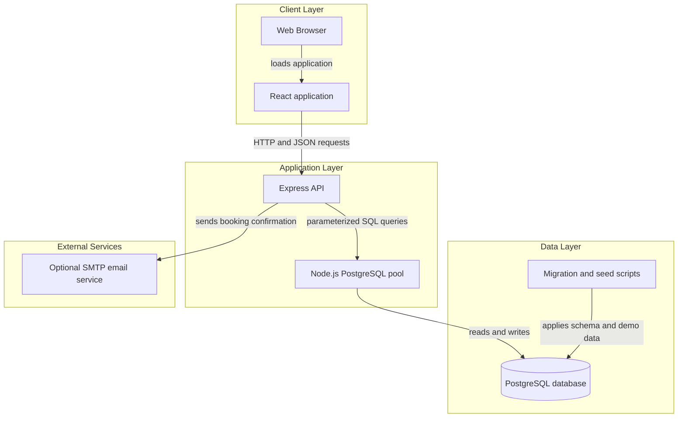
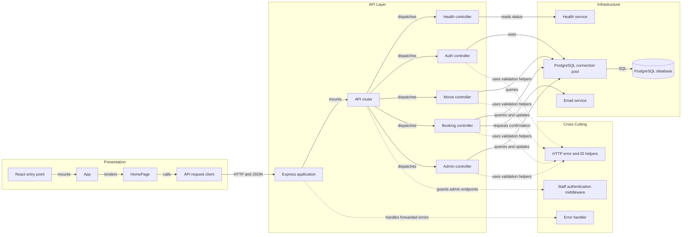

# Architecture Diagram

FlimHall is a full-stack movie theater booking application with a React client, an Express API, and PostgreSQL persistence. This view reflects the implemented source and the finalized database schema.

## Application Architecture

<!-- mermaid-checked: no \n, no em-dash/en-dash, no {} in labels, subgraphs are id["label"], arrows are -->|"label"|, all subgraphs closed by end, ids unique -->

### Technology Stack Summary

| Layer | Technology | Version | Purpose |
|---|---|---|---|
| Client | React | ^19.3.1 | Single-page booking and staff interface |
| Client tooling | Vite | ^8.3.5 | Development server and production build |
| API runtime | Node.js | 20.19+ or 22.12+ | Runs the server application |
| API | Express | ^5.3.0 | HTTP endpoints, routing, and middleware |
| Data access | node-postgres (`pg`) | ^8.23.1 | PostgreSQL connection pooling and queries |
| Data store | PostgreSQL | 14+ | Users, movies, auditoriums, screenings, bookings, and seats |
| Email integration | Nodemailer | ^7.0.10 | Optional booking confirmation through SMTP |

### Data Storage & External Services

PostgreSQL stores staff users, movies, auditoriums, screenings, bookings, and booked seats, as defined in the database migration. The API accesses it through a shared `pg` connection pool; setup scripts apply the migration and demo seed data. SMTP is optional and is used only for booking confirmations. A failed or unconfigured email does not undo a saved booking.

### Key Architectural Decisions

- The React client and Express API are separate applications communicating over HTTP with JSON.
- API routes dispatch to controllers, which issue parameterized SQL directly through the PostgreSQL pool; there is no separate repository or domain-service layer.
- Staff endpoints use signed, time-limited tokens, while booking emails are an optional integration.

## Component Relationships

<!-- mermaid-checked: no \n, no em-dash/en-dash, no {} in labels, subgraphs are id["label"], arrows are -->|"label"|, all subgraphs closed by end, ids unique -->

### Component Inventory

| Component | Layer | Type | Responsibility |
|---|---|---|---|
| React entry point | Presentation | Bootstrap | Mounts the React application |
| App | Presentation | React component | Renders the main page |
| HomePage | Presentation | Page component | Provides movie discovery, booking, booking lookup, and staff tools |
| API request client | Presentation | API service | Sends JSON requests to the configured API base URL |
| Express application | API | Application | Configures CORS, JSON parsing, API routing, and error handling |
| API router | API | Router | Maps health, authentication, movie, booking, and staff routes |
| Health controller | API | Controller | Returns API health status |
| Auth controller | API | Controller | Authenticates staff and issues signed tokens |
| Movie controller | API | Controller | Reads movies, genres, screenings, and seat availability |
| Booking controller | API | Controller | Creates and retrieves customer bookings |
| Admin controller | API | Controller | Manages movies, screenings, auditoriums, and bookings |
| Staff authentication middleware | Cross cutting | Middleware | Verifies staff tokens before admin endpoints |
| Error handler | Cross cutting | Middleware | Converts API errors into logged HTTP responses |
| HTTP error and ID helpers | Cross cutting | Utilities | Creates HTTP errors and validates numeric identifiers |
| Health service | Infrastructure | Service | Provides process uptime and timestamp |
| Email service | Infrastructure | Service | Sends optional booking confirmation messages |
| PostgreSQL connection pool | Infrastructure | Data access | Manages database connections used by controllers |
| PostgreSQL database | Data | Relational database | Persists application records defined by the migration |
