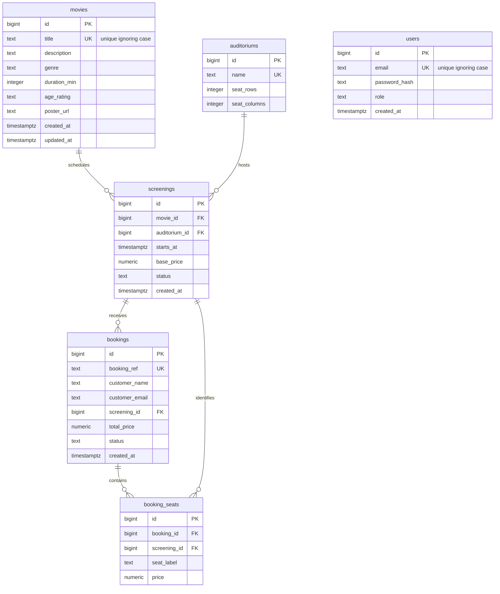

# Data Architecture & Persistence Layer

FlimHall persists its booking domain in a single PostgreSQL database with six tables defined by SQL migration and seed scripts. The Node.js API uses `pg` directly; no ORM or separate repository layer is present.

## Database Configuration

| Service/Module | DB Type | Profile | Driver | Connection | Migration Tool |
|---|---|---|---|---|---|
| FlimHall API | PostgreSQL 14+ | Local/default configuration; no named profiles found | `pg` (node-postgres) | Host, port, database, user, and password are environment-configurable; pool size is 10 | Idempotent SQL migration script, run with the database setup script; no dedicated migration framework |

The migration creates the schema and the seed script inserts demo auditoriums, movies, and screenings. Both are SQL files under `database/`; the API package exposes a database setup command. No alternative database or test profile was identified in the project configuration.

## Data Ownership per Service

| Service | Tables Owned | ORM Framework | Caching | Notes |
|---|---|---|---|---|
| FlimHall API | users, movies, auditoriums, screenings, bookings, booking_seats | None; parameterized SQL via `pg` | None found | Controllers query and update the shared PostgreSQL database directly |

## Entity Model

<!-- mermaid-checked: every attribute is `<type> <name> [<key>] ["<description>"]` with at most one of PK/FK/UK, no \n in descriptions, no {} in descriptions, every relationship label is double-quoted -->

The entity definitions above are in `database/migrations/001_init.sql`; there are no ORM entity classes. Foreign keys restrict deletion of referenced records. The migration defines checks for role, status, positive durations and prices, auditorium dimensions, and nonnegative totals and seat prices. It also defines indexes for screening lookup, booking lookup, and seat availability.

## Key Repository Methods

| Service | Repository | Notable Methods | Purpose |
|---|---|---|---|
| FlimHall API | None; SQL is in `server/src/controllers/` | `listMovies`, `getMovie`, `listScreenings`, `getSeats` | Query movie catalog, schedules, and seat availability |
| FlimHall API | None; SQL is in `server/src/controllers/` | `createBooking`, `retrieveBooking` | Insert booking and seats transactionally; retrieve a booking by reference and customer email |
| FlimHall API | None; SQL is in `server/src/controllers/` | `login` | Find a staff user by case-insensitive email |
| FlimHall API | None; SQL is in `server/src/controllers/` | `listAdminMovies`, `listAdminScreenings`, `listBookings`, `listAuditoriums` | Read staff management data |
| FlimHall API | None; SQL is in `server/src/controllers/` | `createMovie`, `updateMovie`, `deleteMovie`, `createScreening`, `updateScreening`, `cancelScreening`, `cancelBooking` | Maintain catalog, schedules, and booking state |

## Caching Strategy

No application cache, cache provider, or query-result caching configuration was found. The API uses a PostgreSQL connection pool for connection reuse; this is not an application data cache.

## Data Ownership Boundaries

All six tables reside in one PostgreSQL database owned by the FlimHall API. The application has no service-per-database boundaries: controllers access the same database directly through the shared connection pool, and no separate read model or CQRS pattern was found. Multi-table reads use SQL joins and aggregates within the API; no repository interfaces or cross-service aggregation layer are present.

### Data Classification & Sensitivity

| Entity | Sensitive Fields | Classification (PII/PHI/PCI/None) | Controls in Place |
|---|---|---|---|
| users | email, password_hash | PII and authentication data | Passwords are stored as scrypt hashes. Staff management routes require a signed, expiring token. Database encryption-at-rest and email masking are not configured in the repository. |
| bookings | customer_name, customer_email, booking_ref | PII | Booking retrieval requires both reference and matching email; staff management routes require authentication. Database encryption-at-rest and field-level masking are not configured in the repository. |
| booking_seats | seat_label, booking_id, screening_id | None by itself; linked to booking records | No field-level masking or encryption configuration found. |
| movies | None | None | No sensitive fields identified. |
| auditoriums | None | None | No sensitive fields identified. |
| screenings | None | None | No sensitive fields identified. |

No PHI or payment-card data was identified in the schema. The repository does not establish whether the deployed PostgreSQL service provides encryption-at-rest outside application configuration.
