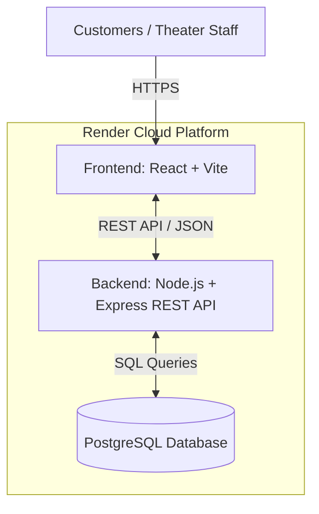
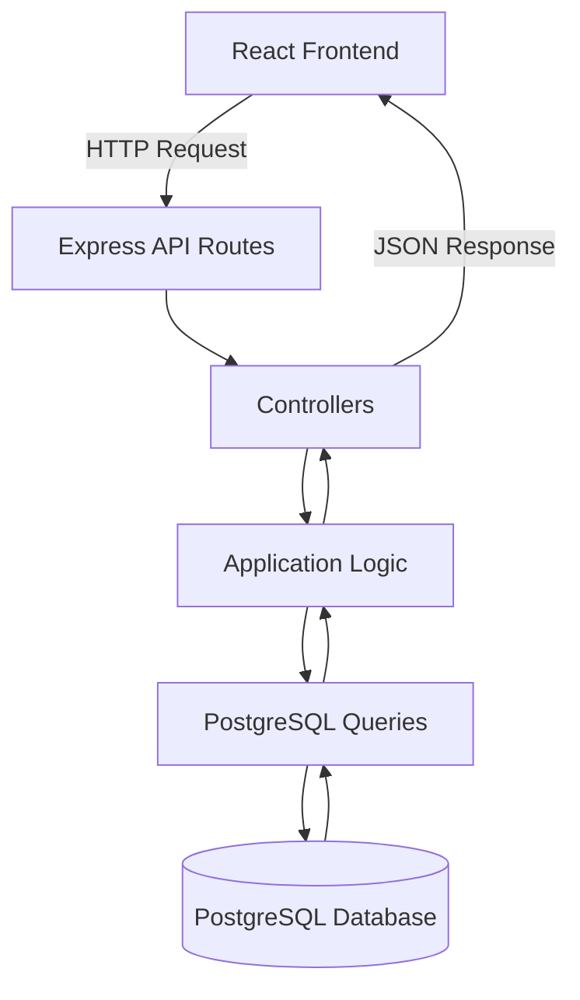
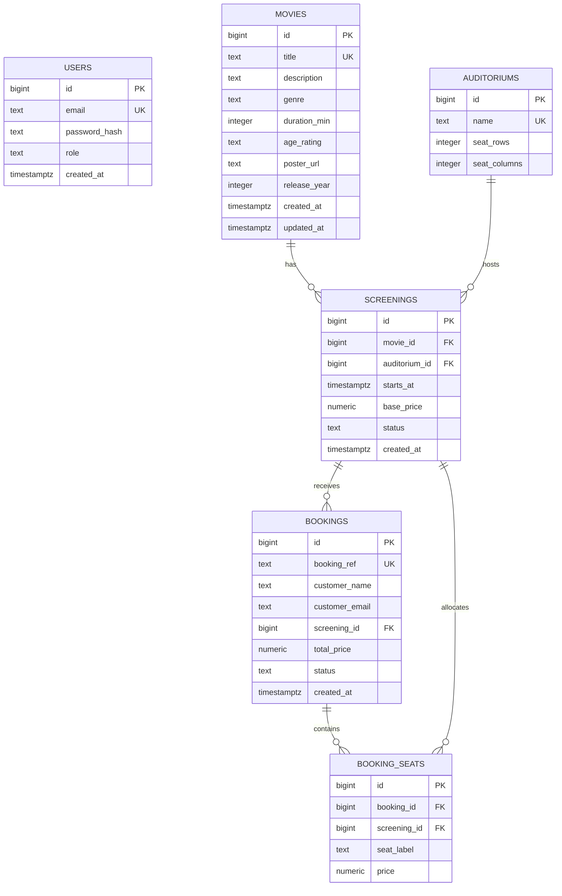
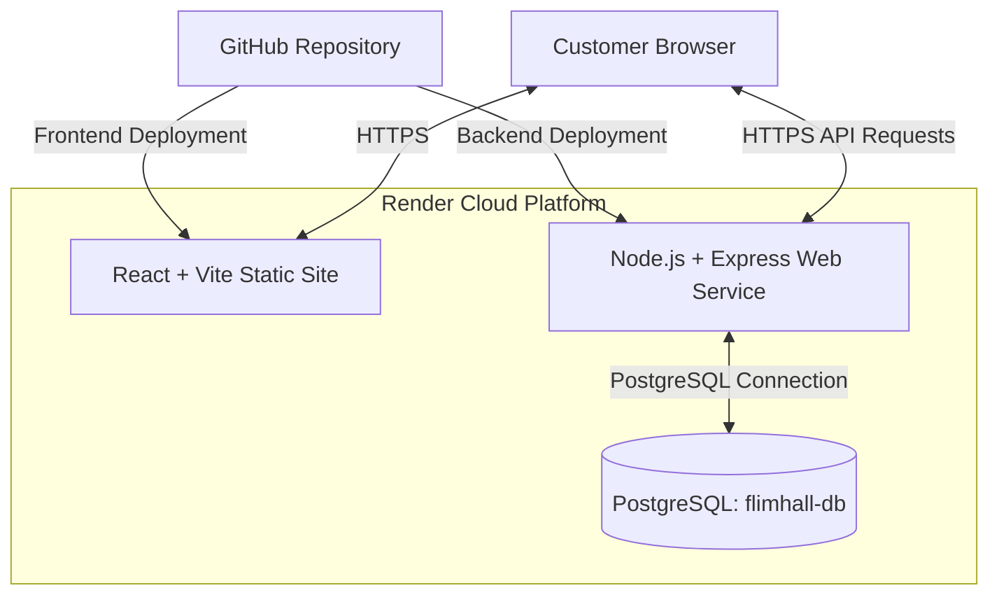

# FilmHall Architecture

## 1. Overview

FilmHall is a movie theater booking web application that allows customers to browse movies, view movie details and screening schedules, select seats, and make bookings. The system is also designed to support theater staff in managing movies, screenings, and booking information.

FilmHall follows a three-tier architecture:

- Frontend: React + Vite
- Backend: Node.js + Express
- Database: PostgreSQL
- Cloud Hosting: Render
- Version Control: Git and GitHub

The frontend communicates with the backend through REST API requests. The backend handles application logic and communicates with PostgreSQL to retrieve and store data.

The movie browsing functionality has been deployed and verified. Additional booking and staff management functionality forms part of the ongoing development.

---

## 2. Architectural Goals

The main architectural goals of FilmHall are:

1. Separate frontend, backend, and database responsibilities.
2. Build a maintainable and reusable REST API.
3. Support movie browsing and screening management.
4. Provide a foundation for seat selection and booking.
5. Protect application data using validation and database constraints.
6. Prevent duplicate seat reservations.
7. Support collaborative development using GitHub.
8. Deploy the application using cloud services.
9. Keep the system extensible for future features.
10. Support testing, security, and reliable application operation.

---

## 3. High-Level System Architecture

FilmHall uses three main application layers:

1. Presentation layer
2. Application layer
3. Data layer

### 3.1 System Architecture Diagram



### 3.2 Presentation Layer

Technology: React, Vite, JavaScript, HTML, CSS

Location: `client/`

Responsibilities:

- Display available movies.
- Display movie details.
- Show screening schedules.
- Provide movie search and filtering.
- Handle customer interactions.
- Support seat selection interfaces.
- Send requests to the backend API.
- Display loading and error messages.
- Provide a responsive user interface.

### 3.3 Application Layer

Technology: Node.js, Express

Location: `server/`

Responsibilities:

- Receive and process HTTP requests.
- Expose REST API endpoints.
- Validate request data.
- Apply application business rules.
- Retrieve information from PostgreSQL.
- Handle booking-related operations.
- Return JSON responses.
- Handle application errors.
- Configure CORS for frontend communication.

### 3.4 Data Layer

Technology: PostgreSQL

Location: `database/`

Responsibilities:

- Store movie information.
- Store auditorium information.
- Store screening schedules.
- Store staff account information.
- Store booking records.
- Store reserved seat information.
- Maintain relationships between database tables.
- Enforce database constraints.

### 3.5 Backend Request Flows



This diagram illustrates the logical request flow. Individual endpoints may implement application logic directly within their controllers.

---

## 4. Application Structure

### 4.1 Frontend

The frontend is developed using React and Vite.

Main responsibilities include:

- Rendering reusable UI components.
- Managing user interactions.
- Requesting data from the backend.
- Displaying movie listings.
- Supporting navigation between application pages.
- Handling loading and error states.

The frontend application is located in:

`client/`

### 4.2 Backend

The backend is developed using Node.js and Express.

The backend follows a modular organization using routes, controllers, configuration, and middleware.

Important files and directories include:

- `server/src/server.js` — Backend server entry point.
- `server/src/app.js` — Express application configuration.
- `server/src/routes/` — API route definitions.
- `server/src/controllers/` — Request handling.
- `server/src/config/` — Configuration.
- `server/src/middleware/` — Express middleware.

Additional modules may be introduced as the application develops.

### 4.3 Database

FilmHall uses PostgreSQL as its relational database.

The database schema is managed through SQL migration files.

```text
database/
├── migrations/
│   ├── 001_init.sql
│   └── 002_movie_release_year.sql
└── seeds/
    └── 001_demo_data.sql
```

Migration files define and update the database schema.

Seed files insert demonstration data for development and testing.

---

## 5. Core Application Flows

### 5.1 Movie Browsing Flow

1. Customer opens the FilmHall website.
2. React loads the movie listing interface.
3. Frontend requests movie data from the backend.
4. Express receives the API request.
5. Backend retrieves movie records from PostgreSQL.
6. Backend returns the movie data as JSON.
7. React displays the movies.

Example endpoint:

```http
GET /api/movies
```

This flow has been verified in the deployed application.

### 5.2 Movie Details Flow

1. Customer selects a movie.
2. Frontend requests movie information.
3. Backend processes the request.
4. PostgreSQL returns the requested information.
5. Frontend displays movie details and relevant screening information.

### 5.3 Booking Flow

The intended booking workflow is:

1. Customer selects a movie.
2. Customer chooses a screening.
3. System displays available seats.
4. Customer selects seats.
5. Frontend submits booking information.
6. Backend validates the booking request.
7. Backend checks seat availability.
8. Booking information is saved in PostgreSQL.
9. Backend returns a booking confirmation.
10. Frontend displays the booking result.

The booking implementation must ensure that two customers cannot successfully reserve the same seat for the same screening.

### 5.4 Staff Management Flow

The planned staff workflow is:

1. Staff member logs into FilmHall.
2. Backend authenticates the staff member.
3. Staff accesses authorized management functions.
4. Staff creates or updates movies and screenings.
5. Backend validates the request.
6. PostgreSQL stores the changes.
7. Updated information becomes available to customers.

---

## 6. Database Design

FilmHall uses PostgreSQL to store application data.

The database contains six main tables:

1. `users`
2. `movies`
3. `auditoriums`
4. `screenings`
5. `bookings`
6. `booking_seats`

The initial database schema is defined in:

`database/migrations/001_init.sql`

The movie release year is added through:

`database/migrations/002_movie_release_year.sql`

### 6.1 Database Entity Relationship Diagram



### 6.2 Database Relationships

| Relationship | Type | Description |
|---|---|---|
| Movies → Screenings | One-to-Many | One movie can have multiple screenings |
| Auditoriums → Screenings | One-to-Many | One auditorium can host multiple screenings |
| Screenings → Bookings | One-to-Many | One screening can have multiple bookings |
| Bookings → Booking Seats | One-to-Many | One booking can contain multiple reserved seats |
| Screenings → Booking Seats | One-to-Many | Seat allocations belong to a specific screening |

### 6.3 Users and Bookings

The `users` table stores staff and administrator accounts.

The `bookings` table stores customer information directly through:

- `customer_name`
- `customer_email`

There is no `user_id` foreign key in the current `bookings` table.

Therefore, the database does not currently define a direct foreign-key relationship between `users` and `bookings`.

### 6.4 Database Integrity

The database uses:

- Primary keys for record identification.
- Foreign keys for relationships.
- Unique constraints and indexes.
- Check constraints for valid values.
- Referential integrity for related records.

Booking operations should use transactions and concurrency-safe seat allocation rules.

The existing `booking_seats` indexes support queries, but an ordinary non-unique index does not independently prevent duplicate active seat reservations.

Additional enforcement is required as the booking functionality is implemented.

### 6.5 Database Documentation

The detailed database ERD is documented in:

`docs/database-erd.md`

This document contains the database entities, attributes, relationships, and design notes.

---

## 7. Security and Reliability

### 7.1 Security

FilmHall should follow these security practices:

- Store credentials in environment variables.
- Keep `.env` files out of GitHub.
- Restrict CORS to trusted frontend origins.
- Validate incoming API requests.
- Protect staff management endpoints.
- Store password hashes rather than plaintext passwords.
- Apply role-based authorization.
- Use HTTPS for production communication.
- Avoid exposing database credentials to the frontend.

### 7.2 Error Handling

The backend should:

- Handle invalid requests.
- Return appropriate HTTP status codes.
- Return consistent JSON error responses.
- Log server-side errors.
- Avoid exposing sensitive error details.

### 7.3 Booking Reliability

Booking functionality should:

- Validate screening identifiers.
- Check available seats.
- Prevent conflicting reservations.
- Use database transactions.
- Maintain consistent booking status.
- Handle failed booking operations safely.

### 7.4 Monitoring

Recommended monitoring includes:

- API availability.
- Backend application errors.
- Database connection failures.
- Deployment status.
- Request performance.
- Booking transaction failures.

---

## 8. Deployment and Environment Model

FilmHall uses Render to host its frontend, backend, and PostgreSQL database.

### 8.1 Deployment Architecture



The browser loads the React application from the frontend static site and sends API requests to the backend web service.

### 8.2 Frontend Deployment

Platform: Render Static Site

Frontend URL:

https://flimhall-frontend.onrender.com

Deployment configuration:

| Setting | Value |
|---|---|
| Root Directory | `client` |
| Build Command | `npm install && npm run build` |
| Publish Directory | `dist` |

Frontend environment variable:

```env
VITE_API_BASE_URL=https://flimhall-api.onrender.com/api
```

### 8.3 Backend Deployment

Platform: Render Web Service

Backend URL:

https://flimhall-api.onrender.com

API Base URL:

https://flimhall-api.onrender.com/api

Example endpoints:

```http
GET /api/health
GET /api/movies
```

The backend processes API requests and communicates with PostgreSQL.

### 8.4 Database Deployment

Platform: Render PostgreSQL

Database Service: `flimhall-db`

PostgreSQL stores the application's persistent information.

The backend connects to PostgreSQL using environment-based database configuration.

Database credentials must not be exposed in frontend code or committed to GitHub.

### 8.5 Local Development

| Component | Local Address |
|---|---|
| Frontend | `http://localhost:5173` |
| Backend | `http://localhost:3000` |
| PostgreSQL | `localhost:5432` |

These addresses represent the expected local development configuration and can be changed through environment settings.

### 8.6 Environment Variables

Example local frontend configuration:

```env
VITE_API_BASE_URL=http://localhost:3000/api
```

Example backend configuration:

```env
PORT=3000
CLIENT_ORIGIN=http://localhost:5173
DATABASE_URL=your_database_connection_string
```

For production:

- The frontend must use the deployed backend API URL.
- The backend CORS origin must match the deployed frontend origin.
- Database credentials must be stored securely.
- The backend must listen on the port provided by its hosting environment.

### 8.7 Deployment Verification

The following checks have been completed:

- Backend health endpoint returned a successful response.
- Movies API returned six movie records.
- Backend connection to PostgreSQL was verified.
- CORS headers were verified for the deployed frontend origin.
- Movie release years were retrieved from PostgreSQL.
- The deployed frontend displayed the six movies.

### 8.8 Production Architecture Verification

FilmHall has been deployed on Render.

The verified movie browsing flow is:

```text
Customer Browser
       |
       v
React Frontend (Render)
       |
       v
Express REST API (Render)
       |
       v
PostgreSQL Database (Render)
       |
       v
Movie Data Returned as JSON
       |
       v
Movies Displayed in React
```

**Result:** Frontend, backend, and database integration is working for movie browsing.

Complete booking and staff management workflows require separate implementation and testing.

---

## 9. Project Folder Structure

The high-level project organization is:

```text
FlimHall/
├── client/
│   ├── public/
│   ├── src/
│   │   ├── App.jsx
│   │   └── main.jsx
│   ├── package.json
│   └── vite.config.js
│
├── server/
│   ├── src/
│   │   ├── config/
│   │   ├── controllers/
│   │   ├── middleware/
│   │   ├── routes/
│   │   ├── app.js
│   │   └── server.js
│   ├── package.json
│   └── .env.example
│
├── database/
│   ├── migrations/
│   │   ├── 001_init.sql
│   │   └── 002_movie_release_year.sql
│   └── seeds/
│       └── 001_demo_data.sql
│
├── docs/
│   ├── database-erd.md
│   ├── git-workflow.md
│   ├── product-backlog.md
│   ├── requirements.md
│   ├── team-roles.md
│   └── team-rules.md
│
├── architecture.md
├── README.md
├── package.json
└── .gitignore
```

This represents the main project structure. Additional files and folders may exist or be introduced during development.

---

## 10. Recommended Future Improvements

### 10.1 Authentication and Authorization

- Implement secure staff authentication.
- Protect administrative API endpoints.
- Introduce role-based authorization.
- Add authentication tests.

### 10.2 Booking System

- Implement seat availability checking.
- Prevent duplicate seat reservations.
- Use database transactions.
- Add booking confirmation.
- Add booking cancellation.
- Test simultaneous booking requests.

### 10.3 Administration

- Add movie management.
- Add screening management.
- Add auditorium management.
- Add booking management.
- Implement staff access controls.

### 10.4 Testing

- Add frontend component tests.
- Add backend API tests.
- Add database integration tests.
- Add end-to-end booking tests.
- Test concurrent seat reservations.

### 10.5 Deployment and Operations

- Improve automated deployment workflows.
- Add application monitoring.
- Add structured logging.
- Document database backup procedures.
- Improve environment configuration.

### 10.6 Performance

- Optimize database queries.
- Improve frontend loading performance.
- Add pagination when needed.
- Reduce unnecessary API requests.

---

## 11. Architecture Decision Summary

FilmHall follows a modular three-tier architecture.

| Layer | Technology | Purpose |
|---|---|---|
| Presentation | React + Vite | User interface |
| Application | Node.js + Express | REST API and application logic |
| Data | PostgreSQL | Persistent relational storage |
| Hosting | Render | Cloud deployment |
| Version Control | Git + GitHub | Team collaboration |
| Communication | HTTPS + JSON | Frontend/backend communication |

### Key Architecture Decisions

1. React and Vite are used for frontend development.
2. Node.js and Express are used for the REST API.
3. PostgreSQL is used for relational data storage.
4. SQL migration files manage database schema changes.
5. Render hosts the frontend, backend, and PostgreSQL database.
6. GitHub supports collaborative development.
7. The application separates presentation, application logic, and data persistence.
8. The database ERD reflects the actual SQL schema, including the absence of a direct users-to-bookings relationship.

---

## 12. Conclusion

FilmHall uses a modular architecture consisting of a React frontend, an Express backend, and a PostgreSQL database.

The application is deployed on Render, and the movie browsing functionality has been verified across the frontend, backend, and database.

The database schema contains six main tables with defined primary keys, foreign keys, constraints, and indexes.

The architecture provides a foundation for further development of screening management, seat reservations, bookings, authentication, and staff administration.

Future work will focus on completing these features and improving security, testing, reliability, and maintainability.
