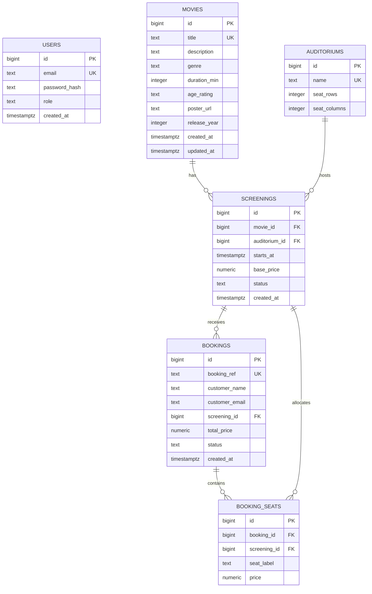

# FilmHall Database ERD

## 1. Overview

FilmHall uses PostgreSQL to store movies, auditoriums, screenings, bookings, booking seats, and staff accounts.

The database contains six main tables defined in `database/migrations/001_init.sql`.

## 2. Entity Relationship Diagram

## 3. Database Relationship

| Relationship | Type | Description |
|---|---|---|
| Movies → Screenings | One-to-Many | A movie can have multiple screenings |
| Auditoriums → Screenings | One-to-Many | An auditorium can host multiple screenings |
| Screenings → Bookings | One-to-Many | A screening can have multiple bookings |
| Bookings → Booking Seats | One-to-Many | A booking can contain multiple seats |
| Screenings → Booking Seats | One-to-Many | Seat allocations belong to a screening |

## 4. Database Design Notes

- PostgreSQL is used as the relational database.
- Primary keys uniquely identify each record.
- Foreign keys connect related tables.
- Booking seats store seat labels instead of referencing a separate seats table.
- Auditorium seating capacity is defined using rows and columns.
- Staff accounts are stored in the `users` table.
- Customer information is stored directly in the `bookings` table.
- The `release_year` column is added through migration `002_movie_release_year.sql`.

## 5. Database Migration Files

- `database/migrations/001_init.sql` — Creates the six main tables.
- `database/migrations/002_movie_release_year.sql` — Adds the movie release year.
- `database/seeds/001_demo_data.sql` — Inserts demonstration data.

## 6. Conclusion

The FilmHall database schema supports movie browsing, screening management, seat reservations, and booking records.

The ERD documents the existing database structure and its relationships.
